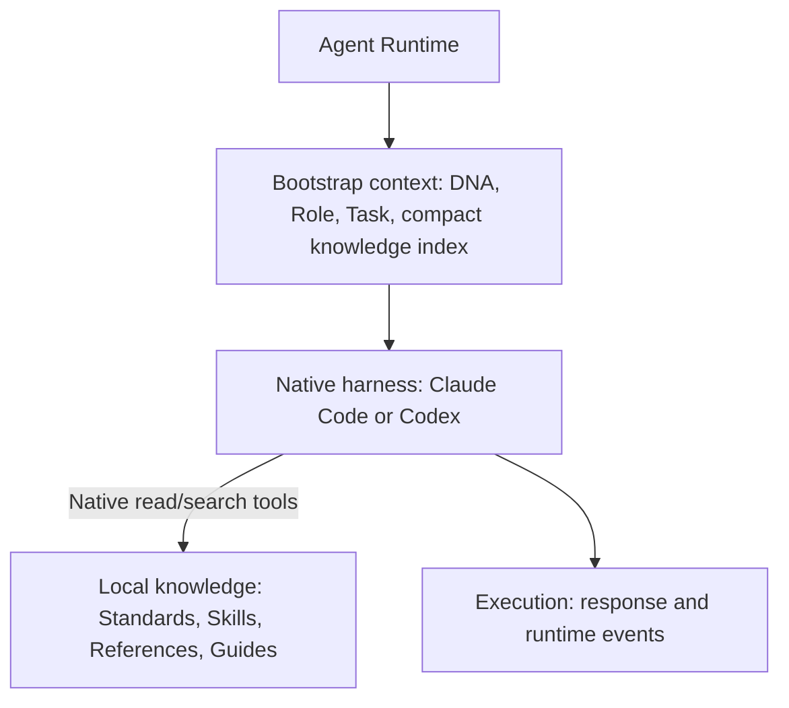

# Agentic Engineering V2

A macOS-first engineering workspace for native Claude Code and Codex harnesses, configurable role knowledge and skills, objective-driven collaboration, and evidence-based completion.

## Development

Go 1.25+, Node 22+, macOS build tools and Wails v2.10.2.

```sh
cd app/frontend
npm install
npm run build
cd ..
go test ./...
go install github.com/wailsapp/wails/v2/cmd/wails@v2.10.2
export PATH="$(go env GOPATH)/bin:$PATH"
wails dev
```

See [app/README.md](app/README.md) and [V2 progress](docs/v2/PROGRESS.md). The desktop still includes demo data; native end-to-end execution is not verified. V1 documentation and source history are preserved; see [archive](docs/archive/v1/README-ARCHIVE.md).

## Target knowledge runtime architecture

The following is the intended architecture, not the current implementation. The knowledge loading contract will be finalized after engineering-knowledge is approved.



Keep bootstrap compact and include applicable mandatory standards before execution. Read optional knowledge on demand through native tools, subject to verified sandbox permissions. No mandatory MCP or additional retrieval infrastructure. Runtime trace must distinguish selection, successful reads, prompt injection and observed native tool reads; estimated tokens are not billed usage. Session reuse, lazy loading and persistence are deferred until the knowledge contract is finalized.
