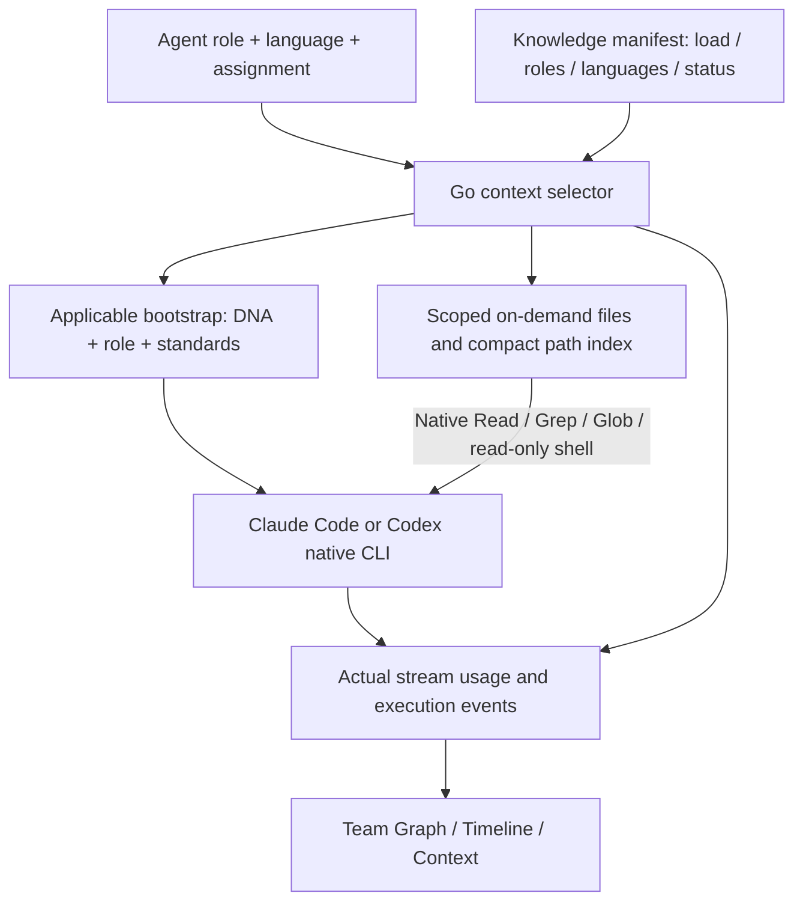

# Agentic Engineering V2

A macOS-first engineering workspace for native Claude Code and Codex harnesses, configurable role knowledge and skills, objective-driven collaboration, and evidence-based completion.

## Development

Go 1.25+, Node 22+, macOS build tools and Wails v2.10.2.

```sh
cd app/frontend
npm install
npm run build
cd ..
go test ./...
go install github.com/wailsapp/wails/v2/cmd/wails@v2.10.2
export PATH="$(go env GOPATH)/bin:$PATH"
wails dev
```

See [app/README.md](app/README.md) and [V2 progress](docs/v2/PROGRESS.md). The desktop still includes demo data; native end-to-end execution is not verified. V1 documentation and source history are preserved; see [archive](docs/archive/v1/README-ARCHIVE.md).

## Knowledge Runtime (draft PR #77)

The backend integration follows the authoritative [engineering-knowledge/main](https://github.com/anvh2/engineering-knowledge/tree/main) manifest v1.0.0. The Go runtime owns applicability, context selection, native process execution and evidence:



- Bootstrap document bodies are bounded by **24 KB per execution**. Skills, references, guides, project profiles and lessons are **not** injected wholesale; only explicitly assigned and applicable on-demand documents are available in a temporary run directory.
- Eligibility comes from manifest `roles` and `languages` rather than file naming. Entry `status: draft` stays provisional even when the pack is `approved`.
- Native CLI token usage is reported separately from size-derived context estimates. For Claude, invocation totals are aggregated from `result.modelUsage` when present; `result.usage` is only a result-level fallback.
- Knowledge trace distinguishes document selection, native-process-start injection, on-demand availability and execution status. **Availability is not proof of a native document read**; observed individual read tracing is not yet implemented.
- Execution evidence currently lives in memory. Session persistence, resume, direct tool-read evidence and an authenticated macOS Claude/Codex E2E remain open; do not describe this feature as production-complete.

The work is isolated in draft [PR #77](https://github.com/anvh2/agentic-engineering/pull/77). No SQLite migrations, mandatory MCP knowledge adapter or unrelated collaboration changes are introduced by this PR.
